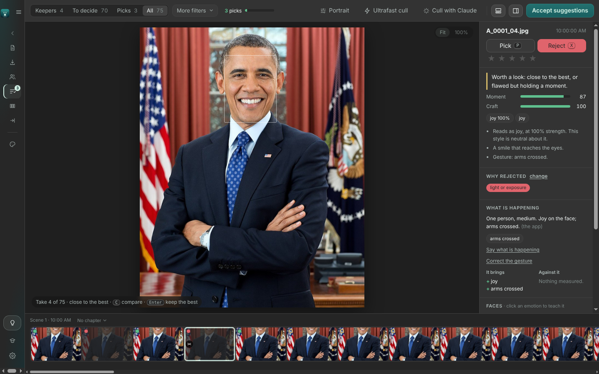
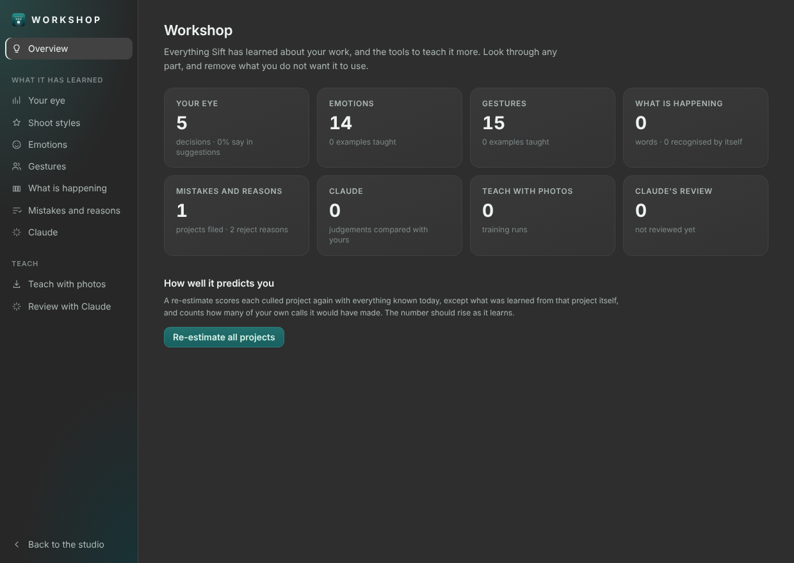
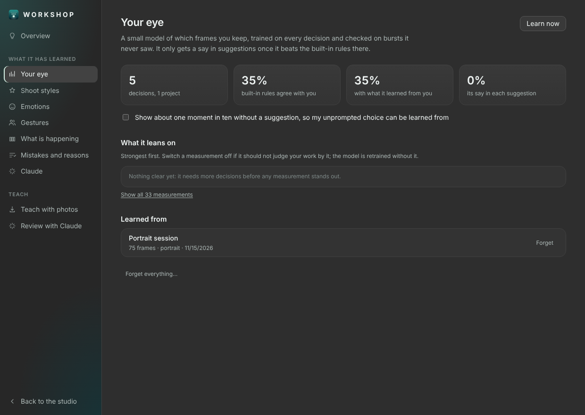

# Sift

**Photo culling that learns the photographer's eye.** A Windows desktop app that takes the
RAW files of a shoot, finds the frames worth keeping, and gets better with every decision
the photographer makes. Everything measurable runs on the user's machine; Claude is an
optional second pair of eyes.



Sift is a TypeScript / Electron / React application of about 17,000 lines, with a unit-test
suite, an end-to-end test that drives the real app, and a CI pipeline that builds and
publishes the Windows installer.

## The problem

A wedding or event can leave 3,000 near-identical frames. Existing AI cullers rank by
technical quality (focus, closed eyes), which is the cheap part: they drop the blurred
frame of a grandmother's laugh and keep ten clean frames of nothing. Photographers also
distrust a verdict that comes without a reason.

## The approach

- **One decision per moment, not per frame.** Frames are grouped into scenes and stacks of
  near-duplicates; the best take of each is suggested.
- **Two scores, shown separately.** *Craft* (focus, eyes, exposure, composition) and
  *moment* (emotion, closeness between people, the peak of a burst). A slider sets how
  much each counts, per kind of shoot.
- **Every suggestion carries its reasons**, as plain sentences: what the frame brings and
  what is against it. Flawed frames that hold a real moment are surfaced as *hidden gems*
  instead of rejected, and a frame the photographer decided is never overruled.
- **It learns, and proves it.** Each pick and reject becomes a training example. The
  learned model only influences suggestions once it beats the built-in rules on decisions
  it never saw (see below).
- **Claude teaches the machine, within limits.** Optional calls read the shoot, describe
  what is happening in each frame, and review everything the app has collected. What comes
  back is stored and used to train the local models, so paid reads make the free local
  reading better. Each call shows a cost estimate first and the real cost after.

| | |
| --- | --- |
|  |  |

## Engineering highlights

| Area | What was done |
| --- | --- |
| **On-device ML** | MediaPipe face, pose, person and segmentation models run in the renderer, on the GPU where WebGL is available (about 37 MB, fetched by script, not committed). Expressions are read as 51 blendshape values; people are told apart from a MobileNet embedding plus clothing colour. Nothing is uploaded unless a Claude button is pressed. |
| **Honest learning** | A logistic + pairwise-ranking model over 33 named measurements, trained locally in milliseconds. 20% of bursts are held out; the model's say in suggestions (0 to 80%) is whichever blend does best on them, and stays at zero until at least 30 comparisons show a gain beyond chance. About one burst in ten is shown with no suggestion so unprompted choices can be learned from. |
| **Learning from corrections** | Merging two people, removing a face, or rejecting for a stated reason is turned into training data: people-matching thresholds are fitted to the photographer's judgements (and used only if they beat the defaults on held-back ones); reject reasons become directions in measurement space. |
| **Human-in-the-loop AI** | "Review with Claude" sends a text digest (numbers and words, never photos or names), validates the structured answer with Zod, sanitises it into proposals, and applies only what the photographer approves, with the effect tested on held-back decisions and set aside if it makes things worse. Prompt caching keeps the repeated briefing at a tenth of the input price across batches. |
| **Desktop architecture** | Electron with context isolation: the renderer never touches the file system or network, and talks to the main process through a typed IPC surface (`StudioApi`). A custom `media://` protocol can only read inside the app's data folder; the API key is encrypted with the OS keystore. Two windows share state through change events. |
| **Data safety** | Originals are never modified. Atomic per-file writes behind a queue, rolling automatic backups with hard-linked unchanged files, a backup before every update or restore, forward-migrating project files, and a data-folder migration for the app's rename. |
| **Delivery** | GitHub Actions: type-check, unit tests on Linux and Windows, build, then a versioned NSIS installer published as a GitHub release. An in-app updater installs a newer version over the old one and keeps the user's data. |
| **Testing** | Unit tests for the pure logic (scoring, grouping, learner, people, knowledge, backups, ...), and a Playwright test that launches the real Electron app and walks every screen with Claude replaced by a stand-in, including drag-and-drop corrections and undo. |

## Architecture

```
┌────────────────── renderer (React + zustand) ──────────────────┐     ┌──────── main (Node) ─────────┐
│ views/      screens: Brief, Import, People, Cull, Story, ...   │ IPC │ store     projects, learning, │
│ store.ts    project state, autosave, undo, learning triggers   │◄───►│           settings, backups   │
│ analysis/   everything measured, learned and scored            │     │ ingest    ExifTool, previews  │
│ knowledge/  built-in Learn library                             │     │ exporter  XMP sidecars        │
└────────────────────────────────────────────────────────────────┘     │ ai        Claude API          │
          src/preload: the narrow typed bridge between them            │ updater   releases, backups   │
          src/shared:  types used by all three                         └───────────────────────────────┘
```

| Layer | Technology |
| --- | --- |
| App shell | Electron 45, electron-vite, electron-builder (NSIS) |
| UI | React 19, TypeScript (strict), zustand |
| Vision | MediaPipe Tasks (Face Landmarker, Pose Landmarker, EfficientDet-Lite0, selfie segmenter, image embedder) |
| Files | exiftool-vendored (RAW previews, XMP) |
| AI | Anthropic SDK, structured outputs with Zod |
| Quality | Vitest, Playwright (`_electron`), GitHub Actions |

Details, module by module, in [docs/ARCHITECTURE.md](docs/ARCHITECTURE.md).

## Run it

Needs Node.js 22.

```bash
npm install
```

```bash
npm run dev
```

`npm install` also downloads the on-device models (about 37 MB). Without them the app
still runs but skips eye and expression checks. The Claude features need your own API key
(Settings); without one, everything else still works.

```bash
npm test
```

```bash
npm run typecheck
```

The end-to-end test launches the real app against a folder of photos (on a machine with no
display, put `xvfb-run -a` in front):

```bash
SIFT_SAMPLES=/path/to/photos npm run test:e2e
```

Build a Windows installer:

```bash
npm run dist:win
```

Every push is built by CI; releases are published as
`Sift-Setup-<version>.exe` and are unsigned, so Windows SmartScreen asks once.

## Status and honest limits

- **Working today:** the whole flow from import to Lightroom hand-off, the learning loop
  and its self-check, people and gesture reading, the Claude features, installer and
  updater. Used on real shoots by the author.
- **Not yet verified:** the in-place updater and data-folder migration are exercised by
  unit tests and by hand, not by an automated Windows test. The end-to-end test needs a
  display and sample photos, so it runs locally, not in CI. The Lightroom preset export
  has not been checked inside Lightroom.
- **Approximate by design:** people are told apart with a general image model, so the same
  person in very different light can be listed twice; the interface makes corrections
  one gesture and learns from them. Emotion is read from the face only, through a general
  expression model, so subtle emotions need the photographer's own examples.
- **No telemetry, no real-world benchmarks:** the app has not been measured against a
  labelled set of professional cull decisions; the self-check in the Workshop is the
  evidence it offers, per user.

The full list is in [docs/FEATURES.md](docs/FEATURES.md#known-limits).

## Documentation

| | |
| --- | --- |
| [docs/CONCEPT.md](docs/CONCEPT.md) | What the product is and how its learning parts fit together |
| [docs/ARCHITECTURE.md](docs/ARCHITECTURE.md) | Processes, modules, data on disk, Claude calls |
| [docs/LEARNING.md](docs/LEARNING.md) | How the taste model learns and is kept honest |
| [docs/FEATURES.md](docs/FEATURES.md) | Full feature catalogue, the culling method, known limits |
| [docs/TRAINING.md](docs/TRAINING.md) | How a photographer teaches the app with their own work |
| [docs/OPERATIONS.md](docs/OPERATIONS.md) | Running cost, updates, backups |
| [docs/ROADMAP.md](docs/ROADMAP.md) | What comes next and why |

## How it was built

Designed and directed by the author, who is a working photographer; implemented in pair
with Claude Code (Anthropic's coding agent), which accounts for most of the commits in
the history. The product decisions, the interface and the testing against real shoots are
the author's.

## Licence

MIT, see [LICENSE](LICENSE). © Fae-ling.
